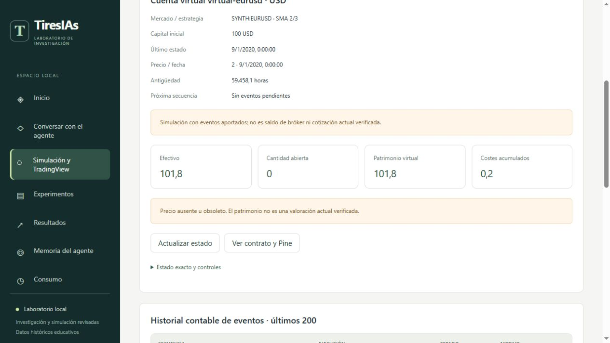

# Avance de FASE 6 — 21/10/2026

**FASE 6 permanece abierta.** Se entrega una base local comprobable de contratos,
Pine generado, referencia OHLC, importación mediante mapa explícito, recepción
duradera y contabilidad virtual. No hay compilación o conexión externa verificadas,
exportación real validada ni órdenes a un bróker. Todo el trabajo permanece local
sobre `47d2fc5`, junto con los cambios anteriores de FASES 5.1 y 5.2, sin commit ni push.
`PROJECT_STATUS.md` conserva el cierre de FASE 5.2; no se actualiza por este avance.

## Implementación

| Incremento | Entregado y comprobado localmente | Pendiente para aceptarlo externamente |
| --- | --- | --- |
| 6.1 | Contratos canónicos versionados, SMA/EMA Pine v6, archivo de alerta y manifiestos SHA-256; descarga en interfaz | Compilar el código en TradingView y comprobar gráfico, propiedades y unidades |
| 6.2 | Referencia Python OHLC, semilla EMA SMA, calentamiento, cruces, aperturas siguientes, posiciones abiertas y comparación de observaciones alineadas | Contrastar resultados del Pine real con la misma fuente y sus casos límite de coma flotante |
| 6.3 | CSV genérico con mapa explícito, vista previa, original exacto, progreso duradero, bloqueo entre importadores y deduplicación | Inspeccionar operaciones y métricas de una exportación real de Strategy Report; no se presume su esquema |
| 6.4 | Receptor autenticado loopback, validación, originales duraderos antes del acuse, estados y procesamiento separado | Diseñar y configurar conexión HTTPS compatible con TradingView, tras revisar cuenta, acceso y costes |
| 6.5 | Cuentas por contrato y moneda, efectivo, posición, costes, PnL, valoración, drawdown y conciliación; consulta y acciones revisadas en la interfaz | Conciliar con informes externos reales, completar recuperación y resolución de discrepancias de esa fuente |
| 6.6 | Requisitos conservados y separación del futuro modo manual respecto a fills de estrategia | Intención desde el chat, revisión, ejecución virtual con precio y riesgo independientes, resultado único enlazado a la conversación |

La nueva pantalla **Simulación y TradingView** prepara paquetes y cuentas mediante
acciones explícitas. Conservar un evento no modifica efectivo ni posición. El
procesamiento requiere revisión de un estado y un inbox determinados: nuevos
eventos, conflictos o cambios contables invalidan la aprobación. Abrir una pantalla
no ejecuta operaciones. Las cinco pantallas originales y la conversación mantienen
sus funciones. La [guía local](../docs/TRADINGVIEW_LOCAL.md) describe uso y límites.

## Verificación

- **396 pruebas aprobadas** de los componentes afectados, incluidas **129 nuevas**.
  La colección completa contiene **1802** casos y conserva los **1673** anteriores.
  Se guardan JUnit, salida, huellas y copias de las fuentes.
- No se ejecutó íntegramente la colección de 1802. La ejecución amplia inicial se
  interrumpió para corregir la semántica temporal de alertas y reforzar los casos
  detectados; su log parcial no acredita una batería completa.
- Se utiliza caché desactivada y un temporal GUID nuevo en cada ejecución,
  conforme a `AGENTS.md`. No se cambian permisos de Windows.
- La selección incluye conversación, interfaz y rendimiento, IA, backtesting,
  investigación, evidencias, registro contable y todos los módulos nuevos.
- Dos procesadores concurrentes no pueden contabilizar dos veces la misma revisión.
  Se comprueban duplicados, conflictos, huecos, retrasos, pérdidas parciales de
  cadena, alteraciones, costes desconocidos, falta de saldo, drawdown, reinicio e
  incompatibilidad del motor. Un cambio de motor conserva la consulta y bloquea
  nuevas acciones; no existe todavía una migración automática de cuentas.
- Sintaxis JavaScript y `git diff --check` correctos. Las advertencias informativas
  de conversión de finales de línea no son errores; las fuentes/evidencias con
  huellas conservan sus bytes mediante `.gitattributes`.

La auditoría de consulta recorre 92 registros: 40 cuentas con detalle y 150 con
resumen, 47 fuentes de consumo y 840 archivos. No cambia sus bytes ni llama a
proveedores, simuladores o reservas. Los 839 archivos de la auditoría de FASE 5.2
siguen idénticos; el archivo añadido es su informe de cierre, escrito después de
aquella auditoría. No se modifica ni reclasifica la evidencia histórica anterior.

## Ensayo artificial y navegador

El ensayo reproducible conserva ocho velas artificiales. La compra se decide en
un cierre de 3 y se ejecuta a la apertura siguiente de 9; la venta se decide en
cierre de 1 y se ejecuta a la apertura siguiente de 11. Con capital 100, cantidad
uno y coste de 1 % por ejecución, el efectivo final es **101,8 USD**, costes
**0,2 USD**, posición **cero**. Es aritmética de una fixture artificial, no una
rentabilidad validada ni una recomendación de costes.

La salida llega antes de la entrada. El inbox conserva ambas sin contabilizarlas,
se reinicia el lector y se procesan en secuencia. La compra llega en formato Pine
de prueba y se repite como evento canónico: un solo efecto. Los costes ausentes
se identifican como estimados según contrato. La valoración final alinea fechas
antes de conciliar con la referencia Python. La conciliación coincide.

La plantilla distingue apertura de vela y emisión de alerta. Su interpretación de
ejecución como apertura procede de la política del contrato y debe contrastarse
en TradingView; los datos artificiales no acreditan un reloj de tick externo.

Un contraste adicional comprueba **48 casos artificiales**, con SMA y EMA,
dos pares de ventanas, doce semillas y los cuatro pares admitidos. Compara
**3360 estados al cierre**: efectivo, cantidad y patrimonio coinciden entre la
referencia OHLC y el libro; también coinciden costes y PnL realizado finales.
Incluye repeticiones de eventos y posiciones abiertas. Para aislar la aritmética,
este ensayo registra un límite de drawdown de 100 % en sus cuentas artificiales;
las pausas de riesgo se prueban por separado y el valor predeterminado de la
aplicación sigue siendo 20 %. No se exige igualdad de drawdown: el libro también
valora las aperturas de ejecución y la referencia lo muestrea en cierres.
El script, semillas, huellas y resultados quedan en `cross-component-result.json`.

En navegador se preparó otro paquete artificial, se revisó su cuenta, se conservó
un JSON y se comprobó el saldo antes y después de aprobar su procesamiento. Con
las fuentes finales se verificaron estado, historial, selector de CSV, mapa,
vista previa y aprobación de importación. Importar dos eventos ya recibidos crea
dos recepciones `duplicate`: conserva el saldo, la posición, los costes y la huella
de la cadena contable. El CSV mantiene exactamente BOM y CRLF. Sin errores o
advertencias de consola. No se realizan llamadas reales al modelo.

El ensayo HTTP aislado realiza treinta consultas por ruta. p95:

| Ruta | p95 |
| --- | ---: |
| Inicio | 18,11 ms |
| Experimentos | 1,27 ms |
| Consumo | 1,60 ms |
| Simulación | 29,90 ms |

Son medidas del espacio artificial con una cuenta y un paquete, sin inferencia
activa; no acreditan el rendimiento con cien cuentas o un despliegue externo.
Las consultas mantienen idénticos los archivos del espacio de ensayo.
Se cierran pestañas y servidores temporales al terminar.

## Diagnósticos conservados

El primer ensayo de integración utilizó por error la constante 101,78 del caso
10→12 para el caso 9→11. La conciliación calculada coincidía; falló esa constante
del comprobador. Se conserva el comprobador original y el diagnóstico, se corrige
a 101,8 y se repite en una raíz nueva, sin reutilizar los registros anteriores.

La revisión de límites detectó que Python 3.14 podía leer más profundidad JSON
que la supuesta por una prueba. Se añade un límite explícito de 64 niveles, sin
depender de su límite de recursión. Una denegación HTTP presentó un aborto de
conexión en Windows al cerrar con el cuerpo pendiente: los rechazos consumen
cuerpos pequeños de forma acotada antes de contestar. Las pruebas posteriores
comprueban tanto la denegación como la ausencia de efectos. Estos diagnósticos
no se ocultan como ejecuciones aprobadas.

## Continuación concreta

1. **Pine y fuente equivalente.** Compilar un paquete con símbolo real revisado,
   confirmar propiedades y unidades, conservar script/gráfico/configuración y
   exportar las mismas velas y observaciones. Resolver diferencias de indicadores,
   calendario, ejecución y posiciones abiertas antes de declarar equivalencia.
2. **Operaciones y métricas reales.** Inspeccionar una exportación real y conservar
   originales. Adaptar IDs, comentarios, señal, ejecución, moneda y costes sin
   rellenar campos ausentes. Completar conciliación y un procedimiento explícito
   para huecos, costes conocidos después y conflictos, sin reescribir asientos.
3. **Alertas externas.** Verificar cuenta, capacidades, límites y costes vigentes;
   definir relay HTTPS y autenticación compatibles, reenvíos, caducidad y recuperación.
   El receptor loopback actual no se publica como servicio final.
4. **Intenciones desde el chat.** Definir un modo manual separado de los contratos
   Pine. La intención debe fijar modo virtual, cuenta, instrumento, lado, cantidad,
   condiciones y caducidad. El modelo solo propone; revisión humana, cotización
   fechada y controles de riesgo autorizan por separado. Conservar aprobación,
   rechazo o ejecución única y enlazar el resultado a la conversación. No consumir
   secuencias de fills externos para simular una petición manual.
5. **Aceptación y cierre.** Repetir fallos/reinicios con datos externos equivalentes,
   revisar trazabilidad y rendimiento y completar la aceptación de FASE 6. Solo
   entonces actualizar `PROJECT_STATUS.md`. Demo y dinero real mantienen las fases
   7 y 8 y sus autorizaciones específicas.

La [hoja de ruta](../docs/NEXT_PHASES.md) conserva los criterios completos. Los
pasos que necesitan cuenta, archivos reales o configuración manual externa se
coordinarán con el usuario; no se han leído credenciales ni habilitado conexiones.

## Archivos de evidencia

La carpeta [phase6-progress-2026-10-21](phase6-progress-2026-10-21/) incluye la
colección, pruebas seleccionadas y diagnósticos parciales, ensayo artificial,
originales de importación, backups SQLite consistentes, comprobación en navegador,
auditoría de consulta, fuentes y manifiestos. No contiene `snapshot.json`: estos
ensayos artificiales no se incorporan al catálogo como investigaciones históricas.
